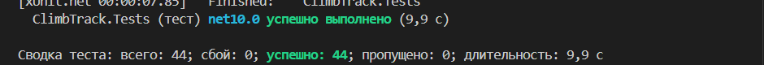

# ClimbTrack

Responsive web application for indoor bouldering enthusiasts: discover routes, log attempts and sends, follow progress and get rule-based route suggestions.

Built with **Blazor Web App (Interactive Server) - C# - .NET 10 - EF Core + SQLite - ASP.NET Core Identity - Bootstrap 5 - xUnit + bUnit**.

## Author: Taimas Torekhan (solo project, AITU - Functional Programming final project).

## Features

| Module | What it does |
|---|---|
| Authentication | Register, sign in/out (cookie auth, lockout after 5 failures), profile with starting grade |
| Route catalog | 30 seeded V0-V10 problems, filter by grade / wall type / name, paging, route details |
| Climbing journal | Create, edit, delete records (date, attempts, sent or not, notes); strictly per-user |
| Dashboard | Completed routes, best grade, sessions, attempts, success rate, grade-distribution chart |
| Recommendations | 3-5 uncompleted routes at the current or next grade (deterministic rules, no external AI) |
| Admin (role-based) | `Admin` role can create / edit / delete routes |
| JSON API | `GET /api/routes`, `GET /api/climbs` (auth), `GET /health` |

## Quick start

Requirements: [.NET 10 SDK]. Works on Windows, macOS and Linux.

```bash
dotnet restore
dotnet run --project ClimbTrack.Web
# open http://localhost:5080
```

The SQLite database (`climbtrack.db`) is created and seeded automatically on first start.

Development accounts (from `appsettings.Development.json`; **change or remove for production**, e.g. via environment variables `Seed__AdminEmail`, `Seed__AdminPassword`):

| Role | Email | Password |
|---|---|---|
| Admin | admin@climbtrack.local | Admin123! |
| Demo user (10 sample climbs) | demo@climbtrack.local | Demo123! |

## Tests

```bash
dotnet test
dotnet test --collect:"XPlat Code Coverage"   # measure coverage
```

- Unit tests: recommendation engine, statistics calculator, filter state, URL sanitising, validation
- Service tests (SQLite in-memory): CRUD, validation, ownership, paging, filters
- Component tests (bUnit): GradeBadge, RouteCard, Pager, GradeChart, StatCard
- Integration tests (`WebApplicationFactory`): API, public page, auth protection, health


Test summary: overall 44, success 44, fail 0.

## Architecture (summary)

```
Components (Razor pages + reusable components)
   -> Services (RouteService, ClimbService, StatisticsService, RecommendationService, CurrentUserService)
      -> EF Core (AppDbContext via IDbContextFactory) + ASP.NET Core Identity
         -> SQLite
```

Pure logic (`RecommendationEngine`, `StatisticsCalculator`) is separate from I/O. Details, diagrams and the ERD: [docs/ARCHITECTURE.md](docs/ARCHITECTURE.md).

## User guide

1. **Browse** `/routes` without an account; filter by grade, wall type or name.
2. **Register**, then press **Log climb** on any route card (or use **Journal -> Add climb**).
3. Enter date, attempts and whether you sent it. Edit or delete entries from the journal.
4. Open **Dashboard** to see statistics and the chart; open **Recommended** for suggested routes.
5. Set your starting grade in **Profile** (used until your first completed route).

## Recommendation algorithm

1. Level = highest grade among the user's completed climbs (or the profile's starting grade, default V0, if none).
2. Candidates = routes not yet completed with grade in `[level, level + 1]`.
3. Sort by grade, then name; return up to 5.

Suggestions are not an assessment of safety or readiness.

## JSON API

| Endpoint | Auth | Description |
|---|---|---|
| `GET /api/routes?grade=&wall=&q=&page=&pageSize=` | no | Paged routes (`wall`: Slab, Vertical, Overhang, Roof, Cave; max page size 50) |
| `GET /api/climbs?page=&pageSize=` | yes (cookie) | The signed-in user's climbs |
| `GET /health` | no | Health check |

## Security notes

Password hashing and lockout via Identity; antiforgery on all forms and on sign-out; every climb query filters by the signed-in user id; validation on both UI and service layer; open-redirect protection on login; admin pages require the `Admin` role.

## Limitations

`EnsureCreated` is used instead of EF migrations; no email confirmation or password reset; SQLite is single-node. See "Future enhancements" in the presentation notes.

## Documentation

- [Architecture and ERD](docs/ARCHITECTURE.md)
- [QA checklist](docs/QA_CHECKLIST.md)
- [Criteria coverage](docs/CRITERIA.md)
