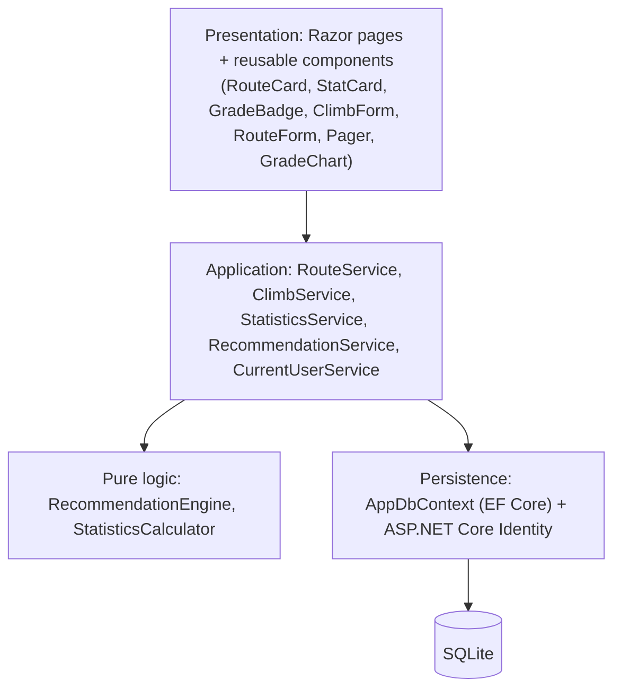
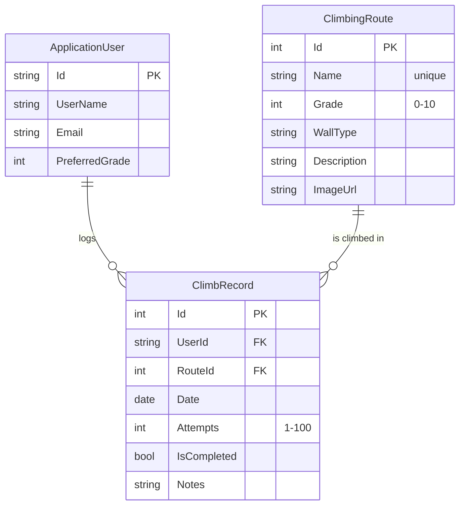

# Architecture

## Layers

- Pattern: layered services with dependency injection (MVVM-like separation of UI, services and models).
- One short-lived `DbContext` per service call, created with `IDbContextFactory` (the recommended pattern for Blazor Server, avoids long-lived contexts per circuit).
- Whole app is interactive (Blazor Server, SignalR circuit) except `/Account/*`, which is static SSR because it sets auth cookies.

## State management

| State | Where | Why |
|---|---|---|
| Catalog filters | `RouteFilterState` (scoped, event-based) | Shared between components; survives navigation inside the circuit |
| Auth state | `CascadingAuthenticationState` | Standard Blazor mechanism |
| Form state | `EditForm` + `ClimbInput` / `RouteInput` | Local, validated with DataAnnotations |
| Durable data | SQLite | Never only in component state |

## ERD

Indexes: `ClimbingRoute(Name)` unique, `ClimbingRoute(Grade, WallType)`, `ClimbRecord(UserId, Date)`, `ClimbRecord(UserId, RouteId)`.
Deleting a user cascades to their records; deleting a route with records is blocked.

## Scalability notes

Queries use `AsNoTracking`, projections, server-side paging and indexes. The database provider is swappable (replace `UseSqlite` with PostgreSQL/SQL Server) without touching services. Statistics are computed from records, so no counters can drift.
