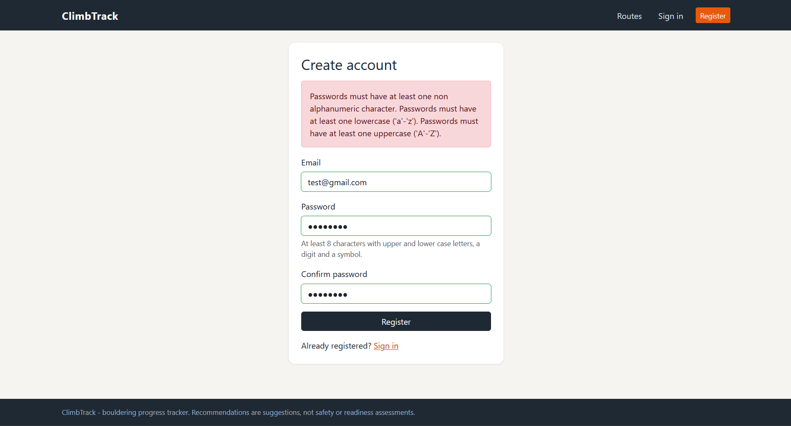
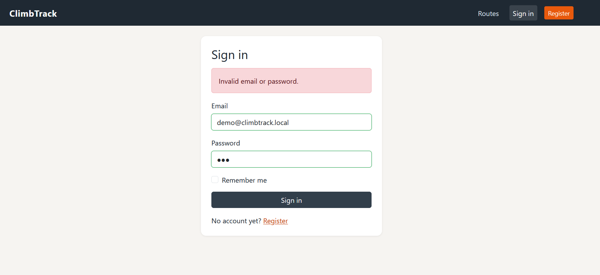
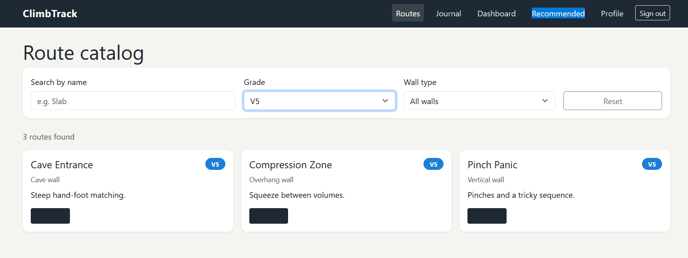
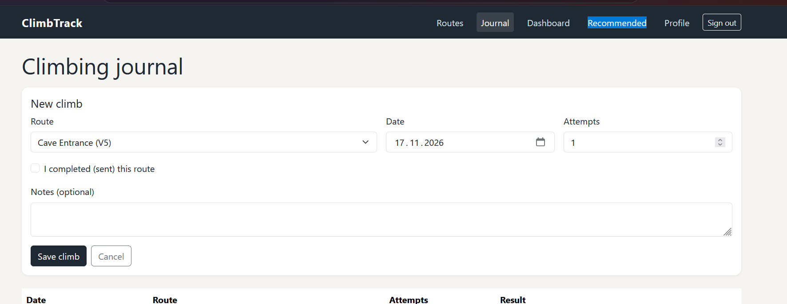
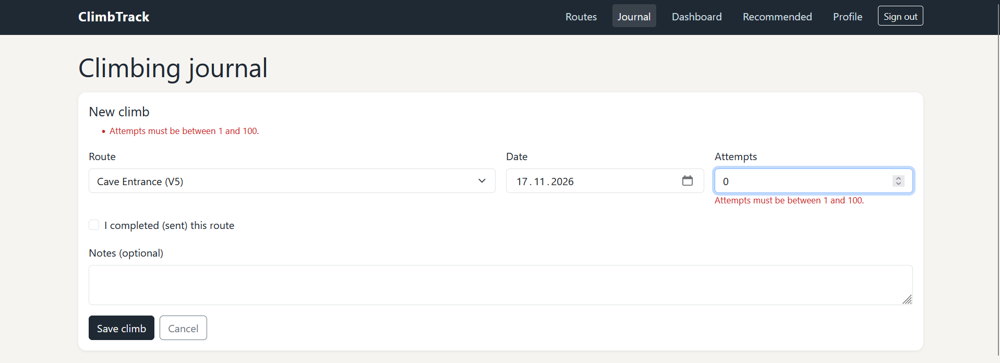
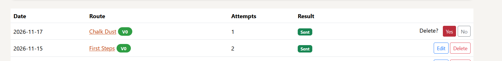
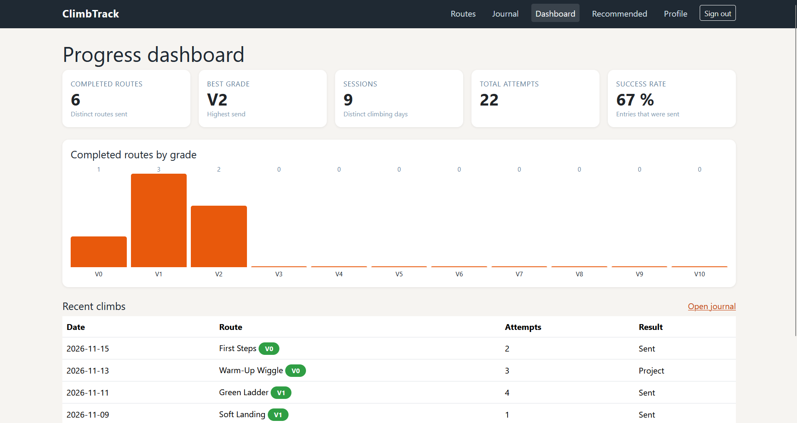
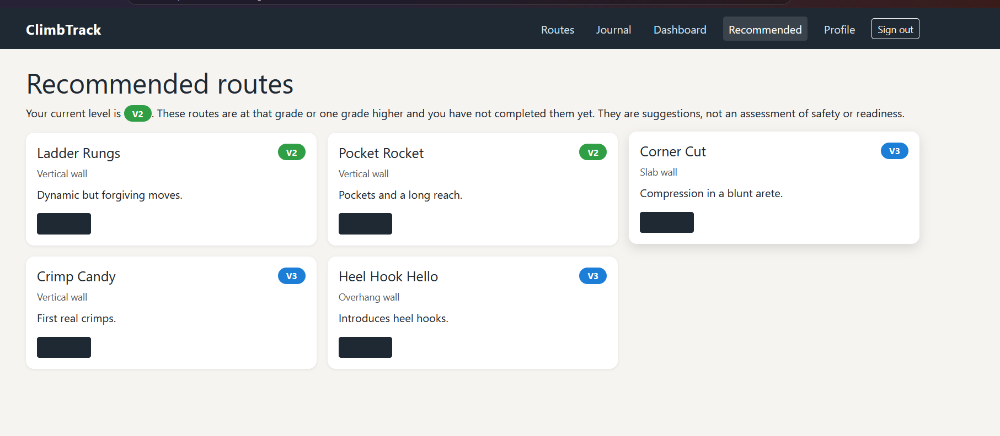
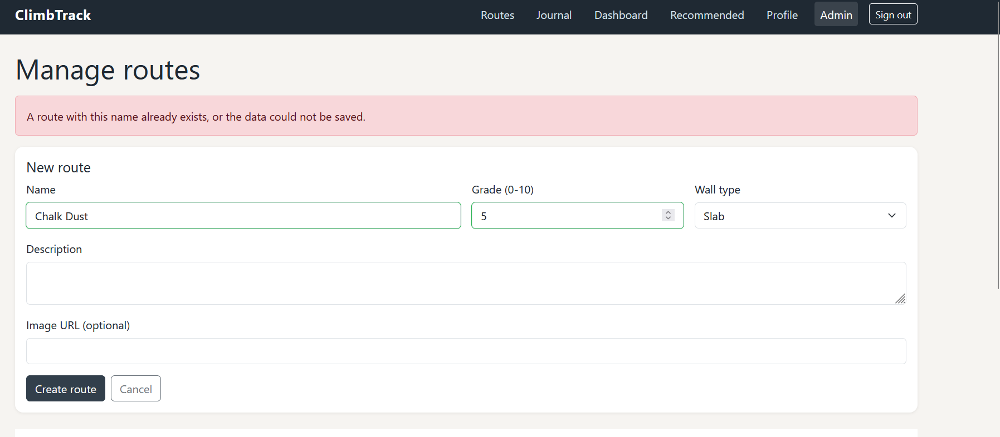

# QA checklist

Record date, browser/device and result for each run.

| # | Scenario | Expected| Browser | |
|---|---|---|---|---|
| 1 | Register with weak password | Clear error message |  | |
| 2 | Register, sign out, sign in | Works; wrong password shows error |  | |
| 3 | Filter catalog by grade + wall + name | Results update; Reset clears filters |  | |
| 4 | Navigate away and back to /routes | Filters are kept 
| 5 | Log climb from RouteCard | Journal opens with route preselected |  | |
| 6 | Add climb with 0 attempts / future date | Validation message, nothing saved |  | |
| 7 | Edit and delete a climb (with confirm) | List updates, message shown |  | |
| 8 | Dashboard after logging sends | Numbers and chart update |  | |
| 9 | Recommendations with history | Vn-Vn+1 routes |  | |
| 12 | Admin creates duplicate route name | Friendly error |  | |
